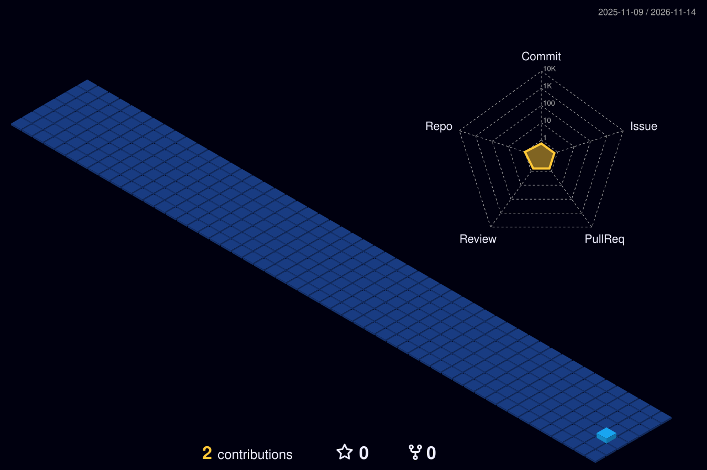

<!-- Character Banner -->

# 🍥 Hi there, I'm Kiruthik!

  

---

### 🥷 About Me — My Ninja Way

> *"Hard work is worthless for those that don't believe in themselves."* — **Naruto Uzumaki**

- 💻 Passionate **Full-Stack Developer** & **.NET Engineer** crafting performant, scalable software.
- ⚔️ **Current Arc:** Windows-based enterprise software with **C#, .NET Framework, WinForms & Telerik UI**.
- 🗄️ Working extensively with **PostgreSQL**, database optimization, complex SQL queries, and **RDLC reports**.
- 🚀 Proven experience building full-stack web applications with **React, Node.js, Express, MongoDB & Django**.
- 🎯 Committed to clean architecture, daily learning, and pushing code that matters.

---

### ⚡ Shinobi Jutsu & Tech Arsenal

  

---

### 📊 Real-Time Shinobi GitHub Stats

<!-- Live General Stats & Streak Stats -->

  

<!-- Top Languages Card -->

 

<!-- Live Real-time Activity Graph -->

---

### 🌃 3D Contribution Village

  

---

### 🍥 S-Rank Missions — Featured Projects

| Mission | Description | Tech Arsenal | Status |
|:---|:---|:---|:---:|
| 🏥 **CareSync** | Hospital appointment booking system with patient & doctor scheduling workflows | React • Node.js • Express • MongoDB | `Completed` |
| 💳 **ExpenseTracker** | Full-stack personal finance & expense management system | MERN Stack • Redux | `Active` |
| 🛍️ **ShopEase India** | Modern e-commerce admin platform with real-time analytics | React Native • Expo • Supabase | `Completed` |
| 📚 **Course Management System** | Comprehensive learning management platform with RESTful backend | Django • DRF • PostgreSQL • React | `Completed` |
| 📈 **Crypto Price Prediction** | Machine-learning model forecasting cryptocurrency market indicators | Python • CNN • BiLSTM • XGBoost | `Completed` |

---

### 📬 Connect With Me

<table>
  <tr>
    <td align="center" width="150">
      
    </td>
    <td>
      
<b>Let's build something epic together!</b>

      
Whether you want to discuss a project, collaborate, or talk tech & anime, feel free to reach out:

      
      
      
    </td>
  </tr>
</table>

 

**"Keep learning. Keep building. Never give up — that's my ninja way!"** 🍥

