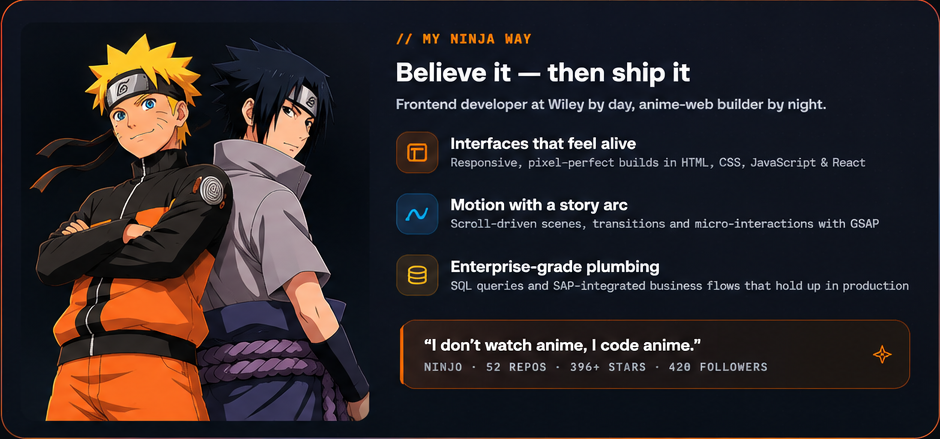
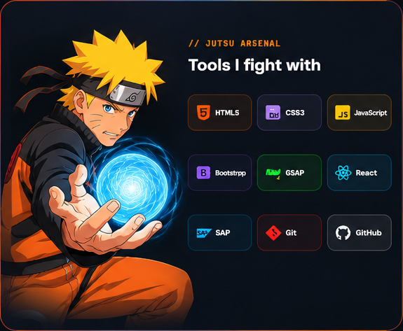
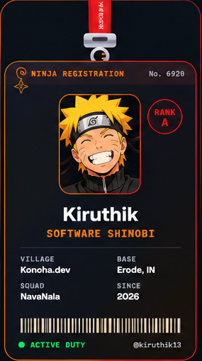
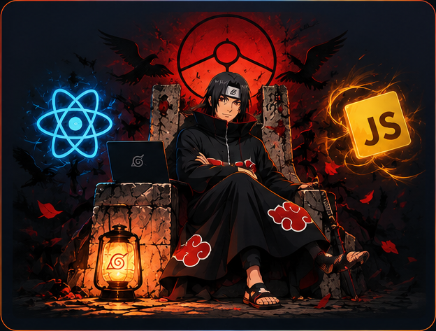

## 🍥 S-Rank Missions — Featured Projects

| Mission | Description | Tech Arsenal |
|---|---|---|
| **CareSync** | Hospital appointment booking system with patient and appointment workflows | React, Node.js, Express, MongoDB |
| **ExpenseTracker** | Full-stack expense management application | MERN Stack |
| **ShopEase India** | Admin application implementation plan for a shopping platform | React Native, Expo, Supabase, Cloudinary |
| **Course Management System** | Course management platform with REST API backend | Django, DRF, PostgreSQL, React |
| **Bitcoin Price Direction Prediction** | Machine-learning project exploring cryptocurrency market indicators | Python, ML, CNN, BiLSTM, XGBoost |

## ⚔️ Current Training Arc

- Developing Windows-based business applications using **C# and .NET Framework**.
- Building user interfaces with **Windows Forms and Telerik UI**.
- Working with **PostgreSQL**, SQL queries, CRUD operations and database integration.
- Creating and troubleshooting **RDLC reports**.
- Strengthening skills in full-stack development, cloud technologies and DevOps.

## 🌃 My Contribution Village

*Every contribution is another step in the shinobi journey.*

## 🧩 Languages & Technologies

**Keep learning. Keep building. Never give up — that's my ninja way.** 🍥

